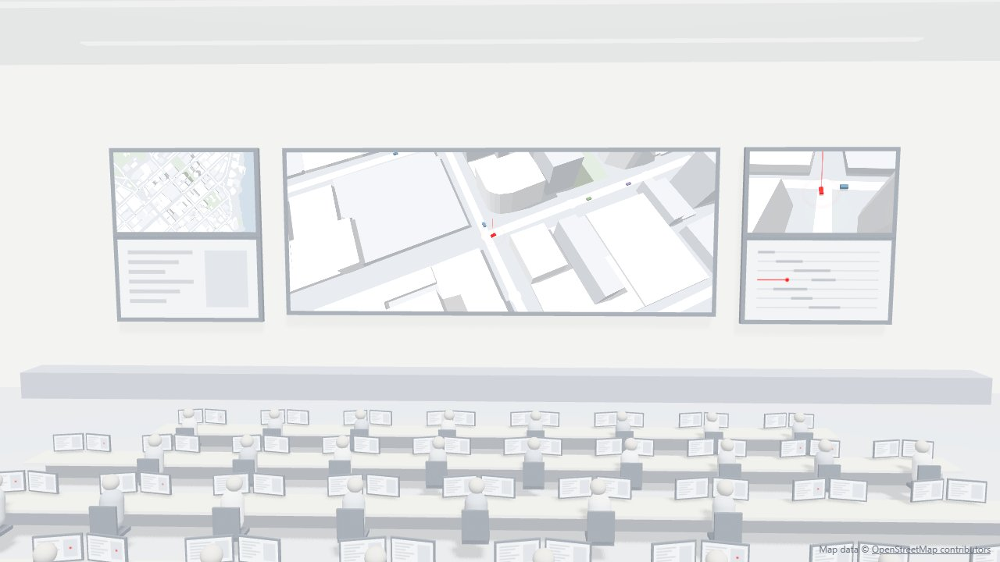

# Ops room

A white operations room, like the ones in spy films, with the centre of Brisbane on its wall of screens. A few hundred cars drive around the city in soft colours. One of them is red.



## Why this exists

We built it for a blog post on our Field Notes:

**[Your next dashboard will look like a Hollywood CIA screen](https://kooka-pacific.com/blog/one-red-car)**

The post argues that a good dashboard works like that film scene: everything in quiet grey, and colour only for the one thing that needs you. This room is the experiment that goes with it. Open it, don't look for anything, and notice where your eyes go.

The code is here for anyone who wants to see how it works or borrow a part of it.

## Run it

You need [Node.js](https://nodejs.org) 20.19 or newer.

```bash
npm install
```

```bash
npm run dev
```

Then open the address that Vite prints, usually `http://localhost:5173`.

## How it works

It's about a thousand lines of TypeScript on top of [three.js](https://threejs.org), with no other runtime dependency.

**Two scenes.** The room and the city are separate three.js scenes. Every frame the city is drawn three times into render targets: from a camera circling the red car, from straight above, and from a chase camera behind it. Those three textures are the faces of the screens on the wall. Then the room is drawn once, screens included. That part is in [`src/OpsRoom.ts`](src/OpsRoom.ts).

**A real street network.** The streets, buildings, river and parks come from OpenStreetMap and sit in [`src/brisbane-cbd.json`](src/brisbane-cbd.json): 262 junctions (79 with traffic lights), 522 street segments and about 1,500 building outlines. Before it went into that file, the raw map was cleaned up: crossings within a few metres of each other were merged into one junction, tunnels and flyovers were dropped, and only the part of the network where every street can reach every other one was kept. That cleanup was a one-off and its script isn't in this repo.

**Traffic that behaves.** Each of the 361 cars follows the [Intelligent Driver Model](https://en.wikipedia.org/wiki/Intelligent_driver_model) by Treiber, Hennecke and Helbing. A car speeds up towards its own preferred speed and brakes to keep a safe gap to the car ahead. Cars keep left, as they do in Brisbane, and slow down for corners. At a junction one approach has the green at a time, and the next one only goes once the junction is empty, so no two cars are ever on the same piece of road. That part is in [`src/traffic.ts`](src/traffic.ts) and doesn't know about three.js, so it's the easiest piece to reuse.

**It stops when you can't see it.** The room only draws while it's on screen. If your device asks for reduced motion, you get one still frame.

### Two honest shortcuts

- Buildings stand at about a third of their real height, so the streets between the towers stay visible.
- Many buildings in the map data have no height at all. Those got nine metres, which is a guess.

## Licence

The code is under the [MIT licence](LICENSE), so use it for whatever you like.

The map data in `src/brisbane-cbd.json` is © [OpenStreetMap contributors](https://www.openstreetmap.org/copyright) and available under the Open Database License (ODbL).

## Who made this

[Kooka](https://kooka-pacific.com) is a small software studio in Brisbane. We design and build websites, dashboards and business software. If you'd like a screen that stays quiet until something needs you, [say g'day](https://kooka-pacific.com/#contact).
